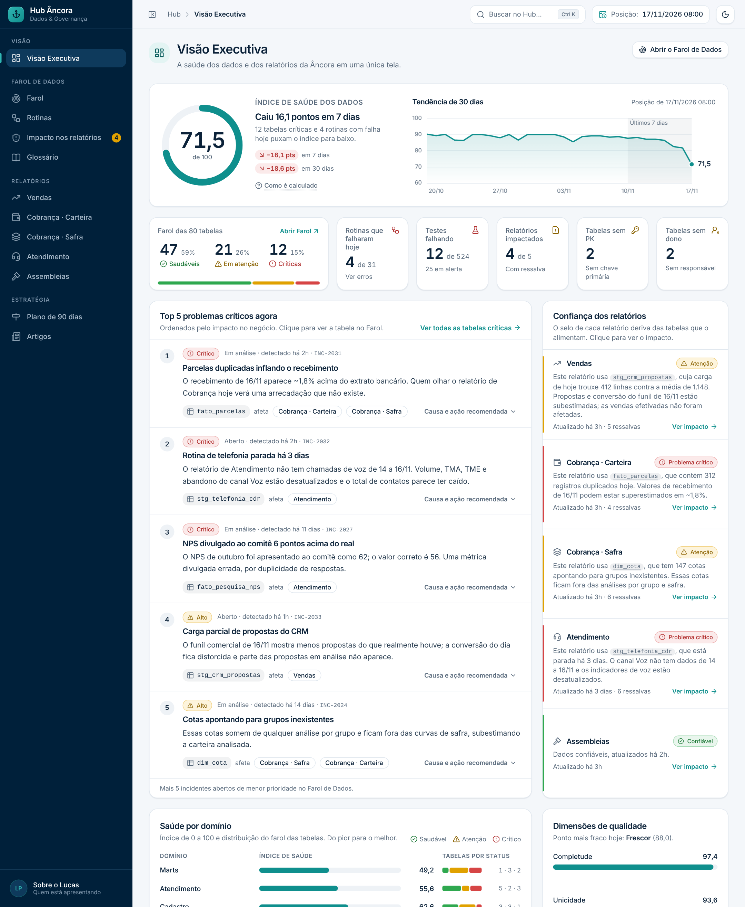
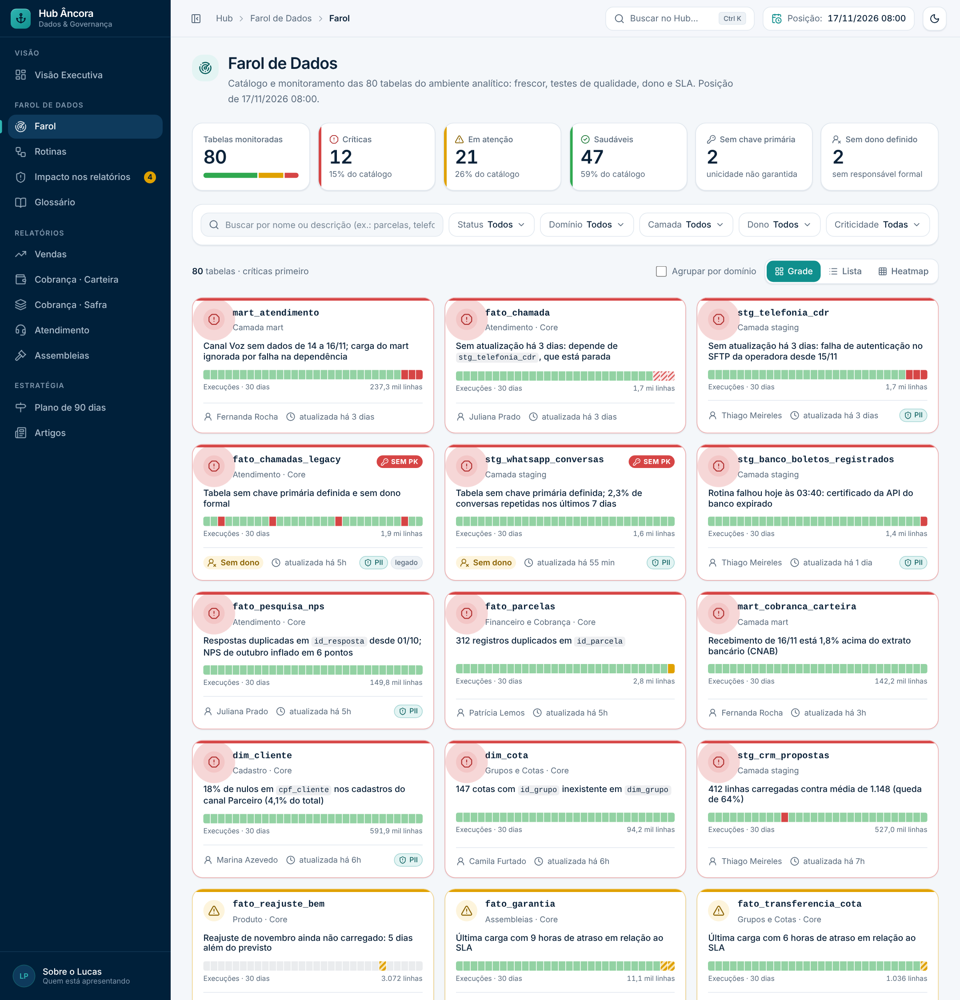
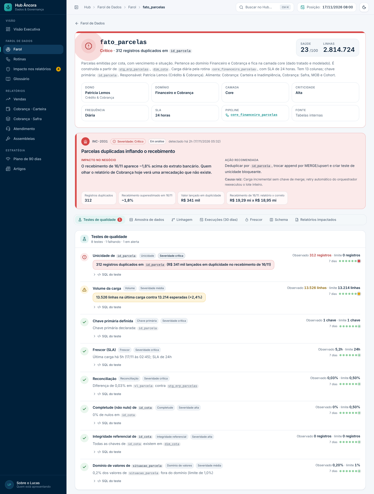
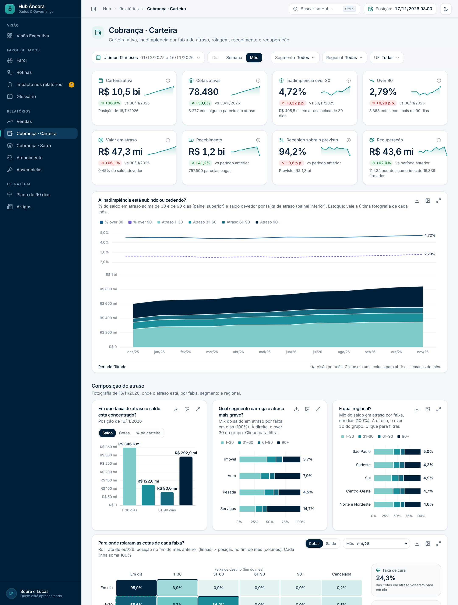
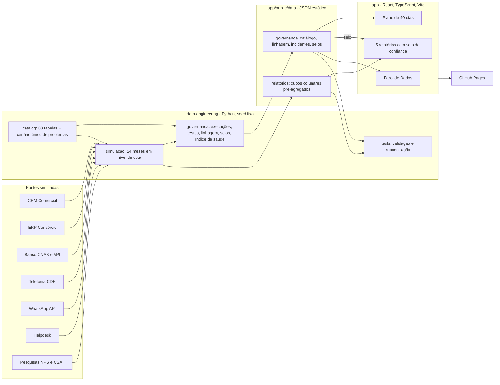

# Hub Âncora · Dados & Governança

Portal executivo e interativo que simula o ambiente de dados de uma administradora de consórcios de grande porte.
Foi construído por **Lucas Pereira** como peça de apresentação para a posição de **Gestor de Dados**.

> Ambiente simulado. Dados fictícios gerados para demonstração. O projeto não usa logotipo, marca nem dados reais de nenhuma empresa.

**A tese do Hub:** relatório confiável depende de dado governado. Cada número exibido carrega um selo de confiança que nasce do monitoramento das tabelas que o alimentam.



## A dor que o projeto resolve

| Dor relatada | Como o Hub trata |
|---|---|
| Informação divulgada de forma incorreta | Selo de confiança em todo relatório e alternância "reportado × corrigido" (caso do NPS: 62 divulgado, 56 real) |
| Rotinas que não atualizam | Farol com frescor contra SLA, histórico de 30 dias e página de Rotinas (caso da telefonia parada há 3 dias) |
| Rotinas que atualizam com dados duplicados | Teste de unicidade com evidência e amostra das linhas (312 parcelas duplicadas inflando o recebimento em 1,8%) |
| Tabelas sem chave primária | Selo "SEM PK" no catálogo e teste de existência de chave em todas as tabelas |

O ponto central é a **ligação entre as duas metades**: o problema nasce em uma tabela, percorre a linhagem e aparece no relatório como um aviso que leva de volta à tabela.

## O que tem no portal

| Área | Conteúdo |
|---|---|
| **Abertura** | Cartão de visita executivo de uma tela: quem apresenta e por quê |
| **Visão Executiva** | Índice de Saúde dos Dados, farol das 80 tabelas, rotinas com falha, Top 5 problemas em linguagem de negócio |
| **Farol de Dados** | Catálogo das 80 tabelas em grade, lista e heatmap de 30 dias; detalhe com frescor, execuções, testes, schema, linhagem interativa e amostra |
| **Rotinas** | Pipelines, agenda, taxa de sucesso e falhas recorrentes |
| **Relatórios** | Vendas, Carteira e Inadimplência, Safra/MOB/Cohort, Atendimento, Assembleias e Contemplações |
| **Plano de 90 dias** | Diagnóstico, padronização e monitoramento, com métricas de sucesso e projeção do índice |
| **Glossário e Artigos** | Definição oficial das métricas e textos do autor |





## Arquitetura



Decisões que valem destacar:

- **Cenário único de problemas** (`data-engineering/catalog/cenario.py`). A simulação de negócio e o motor de governança leem as mesmas constantes, então o número que aparece no incidente é o mesmo que distorce o gráfico.
- **O farol é calculado, não declarado.** O status de cada tabela nasce das execuções e dos testes simulados, e um teste automatizado confere que o resultado bate com o cenário desenhado.
- **Cubos colunares pré-agregados.** Os relatórios carregam apenas medidas aditivas; razões como ticket médio, TMA, NPS e percentual de inadimplência são calculadas no navegador, o que mantém todos os filtros corretos.
- **Sem backend.** Tudo é JSON estático, versionado e reproduzível.

## Modelo de dados

80 tabelas em três camadas (`stg_*` → `dim_*` / `fato_*` → `mart_*`) e dez domínios: Staging, Cadastro, Produto, Grupos e Cotas, Vendas, Financeiro e Cobrança, Assembleias, Atendimento, Corporativo e Marts. A lista completa, com dono, SLA, pipeline e linhagem, está em [`data-engineering/catalog/tabelas.py`](data-engineering/catalog/tabelas.py).

## Como rodar

Requisitos: Node 20+ e Python 3.11+ com `numpy` e `pandas`.

```bash
# 1. (opcional) regenerar todos os dados e rodar as validações
python3 data-engineering/run_all.py

# 2. front-end
cd app
npm install
npm run dev        # desenvolvimento
npm run build      # produção, saída em app/dist
```

Os JSONs já estão versionados em `app/public/data`, então o passo 1 só é necessário para alterar o cenário.

## Publicação

O workflow [`.github/workflows/deploy.yml`](.github/workflows/deploy.yml) valida os dados, faz o build e publica no GitHub Pages a cada push na branch `main`. Para ativar: **Settings → Pages → Source: GitHub Actions**.

## Estrutura do repositório

```
app/                 front-end (React, TypeScript, Vite, Tailwind, shadcn/ui, ECharts, TanStack Table, React Flow)
data-engineering/    catálogo, simulação, motor de governança, SQL e testes
docs/                contratos, roteiro de demo e prints
CLAUDE.md            memória viva do projeto
```

## Documentos

- [Roteiro de demo de 3 minutos](docs/roteiro-demo.md)
- [Contratos compartilhados](docs/contratos.md)
- [Memória do projeto](CLAUDE.md)

## Personalização

Os dados do candidato ficam em `app/src/content/perfil.json` (LinkedIn, e-mail, agenda, foto) e os artigos em `app/src/content/artigos.json`. Campos marcados com `[PREENCHER]` aparecem desabilitados até serem informados.
